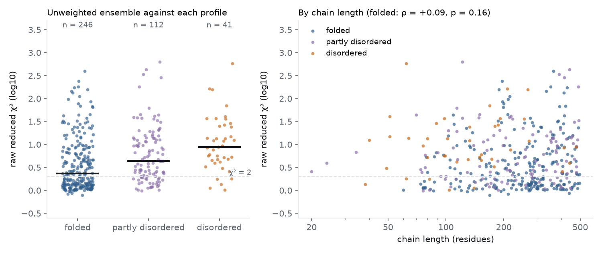

# bioemu-saxs-campaign

**Where does BioEmu-1 disagree with solution scattering, and which proteins should be measured next?**

Project page: <https://natalija-stepurko.github.io/bioemu-saxs-campaign/> · design: [`docs/DESIGN.md`](docs/DESIGN.md) ·
campaign proposal: [`docs/CAMPAIGN.md`](docs/CAMPAIGN.md)

## Result

Scored without reweighting against 399 quality-filtered small-angle X-ray scattering (SAXS) profiles from
SASBDB that have a BioEmu-1 ensemble, 37% of the raw ensembles meet the χ² ≤ 2 threshold (146 of 399; 95%
interval 32–41%). The median raw χ² is 2.3 for folded proteins, 4.3 for partly disordered and 8.9 for
disordered; under NRMSD, a second score that does not weight by the reported errors, the three class
medians are similar (0.030, 0.034, 0.031), while the ordering of the seven models in the PeptoneBench
archive is unchanged, with BioEmu-1 first. Reweighting each ensemble towards its profile sorts the entries
into 146 raw fits, 77 modestly reweightable, 106 strongly reweightable and 70 whose target fit is not
reached by the tested procedure. One expectation came out in the opposite direction: BioEmu-1's
disordered ensembles are too extended (median radius of gyration 1.21 times the measured value, interval
1.12–1.28), and the Cα coordinates of the sampled conformers give 1.35, so the extension is present in the
conformers. The raw error is not predictable before measuring (R² = 0.05 in sequence-grouped
cross-validation); ranking held-out entries by predicted error gives a high-discrepancy target yield of
0.51 among the top ten against 0.44 for random choice, within the spread of a single random pick. The priority score
proposed in the design does no better than random choice when fed pre-measurement quantities, so it is not
used to recommend measurements. The campaign proposal therefore has a replication arm, systems chosen by
stated eligibility rules, under standardised conditions and a prospective test of the extension
bias with pre-specified model-based selection and scaling-law-matched controls.

Against experimentally known structure space (CATH v4.4 at the S35 level, non-redundant PDB clusters and
Swiss-Prot), the SAXS set covers common folds and few rare ones (34 of the 50 most populated CATH
superfamilies, 43 of the 4,630 ranked beyond 2,000), over-represents mainly-β domains, human proteins and
disorder, under-represents α/β enzyme folds, and consists of fragments of at most 500 residues cut from long
multidomain proteins; 26% of the mapped constructs have no experimental structure covering half of them.
Measured against BioEmu-1's own training data (the 50,228 AFDB pre-training clusters, the simulated CATH and
MegaSim systems, the MEGAscale wild types), disorder is nearly absent from training (1.7% of AFDB input chains
and 0.3% of simulated domains predicted mostly disordered, against 15.5% of the constructs), pre-training is
81% bacterial with 0.2% human clusters, mainly-β domains are thin, and no simulated chain reaches 200
residues; α/β enzyme folds are not thin in training. Few measured proteins are close to the training data:
165 of the 399 profiles have a training sequence of at least 30% identity over half the construct, 23 of at
least 90%. Pooled, the raw fit improves with closeness, but within each disorder class no measure of the error
varies with it (12 Spearman tests, every Holm-adjusted p ≥ 0.35), and superfamily presence in the training data
does not separate the errors. Whether a construct has an experimental structure does not explain the raw error
once the disorder class is accounted for either (class-stratified van Elteren p = 0.39). These results open the
recommendation section of the page, which lists the protein data to collect with their evidence: disordered
proteins, folded proteins with long disordered regions, and full-length multidomain proteins above 500 residues.



## What was done

All inputs are public: the 439 profiles with sequences and disorder scores (PeptoneDB-SAXS, curated from
SASBDB) and the BioEmu-1 ensembles with their Pepsi-SAXS back-calculated curves generated by the
PeptoneBench authors (Zenodo record 17306061, CC-BY 4.0; archives `PeptoneDBs.tar.gz` and
`Predictions.tar.gz`, md5 verified against the record, sha256 recorded in `data/checksums.json`). The
ensembles were generated with BioEmu at code commit ac7455d; the archive does not record the checkpoint
version, and re-sampling with the current v1.2 checkpoint is the first follow-up
(`notebooks/bioemu_resample.ipynb` prepares it). This study does not re-sample the model; it re-analyses
that output. Each raw fit scales the ensemble average to the data with one factor and one constant
background. A Guinier fit gives the experimental radius of gyration and flags aggregation. Maximum-entropy
reweighting along a path of prior strengths gives, per entry, the effective sample fraction that must be
spent to reach a given fit. Entries whose measured molecular weight exceeds 1.6 times the sequence mass
are excluded as oligomers. Four expectations were written down before scoring (DESIGN §5); one was met, one
reversed, two not met. The additions made after the first run are listed, dated, in DESIGN §7.

## Pipeline

| Stage | Does |
|---|---|
| `bsc fetch` | downloads the two Zenodo archives, verifies their md5 against the record, records sha256, unpacks the SAXS data and the back-calculated curves of the chosen models |
| `bsc score` | per entry × model: raw χ², the error-free NRMSD score, Guinier Rg (experiment and ensemble), reweighting path, data-quality flags |
| `bsc coordrg` | Cα radius of gyration of the BioEmu-1 conformers for every clean disordered entry and 40 random folded ones (the worked examples are added for the figure and kept out of the class statistics); `-- --archive Predictions.tar.gz` extracts the missing ensembles in one pass |
| `bsc analyse` | error map by class, the four expectations, the four kinds, model comparison, the design's priority score (reported and tested, not used to select systems), bootstrap intervals, near-duplicate clusters, NRMSD orderings |
| `bsc select_eval` | retrospective evaluation of the selection rule on held-out folds grouped by sequence cluster |
| `bsc predict` | can the error be predicted before measuring: grouped, repeated cross-validation of baselines, linear models and small trees |
| `bsc coverage` | where the SAXS set sits in structure space and against BioEmu-1's training data, the raw fit split by PDB coverage of the construct and by closeness to the training data (pooled and within each disorder class), and the error on candidate protein categories for data collection; reads only `results/coverage/` and `results/resolvability.csv` |
| `bsc envelopes` | DENSS ab initio envelopes of the three worked examples (needs the DENSS environment, see below; skipped with a notice otherwise) |
| `bsc report` | figures, `docs/CAMPAIGN.md` and the campaign arms from `results/` |

`python3 docs/site/build.py` builds the project page from `results/`; it stops if the prose and the numbers
disagree, including every sentence that states a direction or a comparison.

## Reproduce

```bash
uv sync --locked --group dev
make test                                # pytest, synthetic data, offline
uv run bsc fetch                         # ~16 GB download from Zenodo; ~2 min to unpack what is needed
make all ARCHIVE=data/archives/Predictions.tar.gz    # every stage after the download, then the page
make page                                # the page alone, from the tracked results/
```

`BSC_ROOT` moves data and results elsewhere; `bsc fetch -- --archive-dir DIR` reuses archives already
downloaded; `BSC_N_JOBS` sets the worker count (default 4). The tracked `results/` (per-entry scores,
reweighting paths, kinds, candidates, coordinate Rg, the validation outputs, the DENSS fit statistics and
the figures) let `analyse`, `select_eval`, `predict`, `report` and the page rebuild without the download.

### The coverage analysis

`analysis/coverage/` maps every construct to a UniProtKB region and compares the set with CATH, the PDB and
Swiss-Prot (scripts 00–10), then obtains BioEmu-1's public training data (AFDB cluster definitions, the
simulated systems read out of the Zenodo archives by HTTP range requests, MEGAscale) and compares it with the
SAXS set and searches every construct against it with MMseqs2 (scripts 11–17); both are described with
database versions in [`analysis/coverage/README.md`](analysis/coverage/README.md). It needs network access,
about 1 GB of downloads, its own requirements (`analysis/coverage/requirements.txt`, not part of the main
environment) and the MMseqs2 binary. Its small outputs (the per-entry mapping, the summary of all comparisons,
a CATH superfamily rank table, the per-construct nearest training sequences, the training-data summary, the
SASBDB measurement metadata and the database versions) are tracked in `results/coverage/`, so `bsc coverage` and the page rebuild without it.

```bash
uv venv /path/to/venv-cov && uv pip install --python /path/to/venv-cov -r analysis/coverage/requirements.txt
COVERAGE_PY=/path/to/venv-cov/bin/python COVERAGE_WORK=/path/with/2GB/free MMSEQS=/path/to/mmseqs \
  BSC_ROOT=<where bsc fetch put data/> analysis/coverage/run_all.sh
uv run bsc coverage
```

### Checks on the Arm 1 list

`analysis/arm1/arm1_checks.py` asks whether the large raw χ² of the twelve Arm 1 systems reflects the precision
of their deposited data (relative error of each curve against raw χ² and NRMSD, raw χ² by SASBDB curve and source
type, the twelve against the eligible pool) and whether the twelve are related (organism, sequence group,
superfamily). It reads the SASBDB metadata table written by `analysis/coverage/18_sasbdb_metadata.py` and writes
`results/arm1/`; see [`analysis/arm1/README.md`](analysis/arm1/README.md).

```bash
BSC_ROOT=<where bsc fetch put data/> uv run python analysis/arm1/arm1_checks.py
```

### The DENSS environment

DENSS (Grant 2018) needs numpy < 2, so it lives in its own virtual environment; `bsc envelopes` looks for
it at `BSC_DENSS_ENV` (default `/scratch/.venv-denss`) and runs `denss-all` from there, ten maps in FAST
mode per example with Dmax from the SASBDB record. Without that environment the stage prints a notice and
`bsc report` keeps the tracked `fig_examples.png`.

```bash
python3 -m venv /scratch/.venv-denss && /scratch/.venv-denss/bin/pip install "numpy<2" denss
BSC_DENSS_ENV=/scratch/.venv-denss uv run bsc envelopes
```

The reconstructions themselves (`results/denss/`) are not tracked; `results/denss_stats.json` keeps their
fit statistics.

`bsc report` then docks the highest-weight BioEmu-1 conformer of each example into its averaged map by
principal axes and draws the envelope as projected silhouettes of two density levels (the particle volume
DENSS assigned and the protein's expected volume) with the conformer's Cα trace on top. The ensembles of the
examples are extracted from the archive by `bsc coordrg -- --archive Predictions.tar.gz`.

## What is tracked and what is not

Tracked: everything under `results/` except the DENSS maps, and the documents. Not tracked: the Zenodo
archives and the unpacked curves and ensembles (`data/`, rebuilt by `bsc fetch` and `bsc coordrg`),
because they are already public under CC-BY 4.0 and are large, and the downloads of the coverage analysis
(CATH, Swiss-Prot, PDB clusters, per-protein annotations and BioEmu-1's training data, about 1 GB).

## Licence

MIT for the code. The inputs keep their own licence (CC-BY 4.0, Invernizzi et al. 2025; SASBDB data as
deposited).

## Cite

```bibtex
@misc{stepurko2026bioemusaxs,
  author = {Stepurko, Natalija},
  title  = {Where does BioEmu-1 disagree with solution scattering, and which proteins should be measured next?},
  year   = {2026},
  url    = {https://github.com/Natalija-Stepurko/bioemu-saxs-campaign}
}
```
